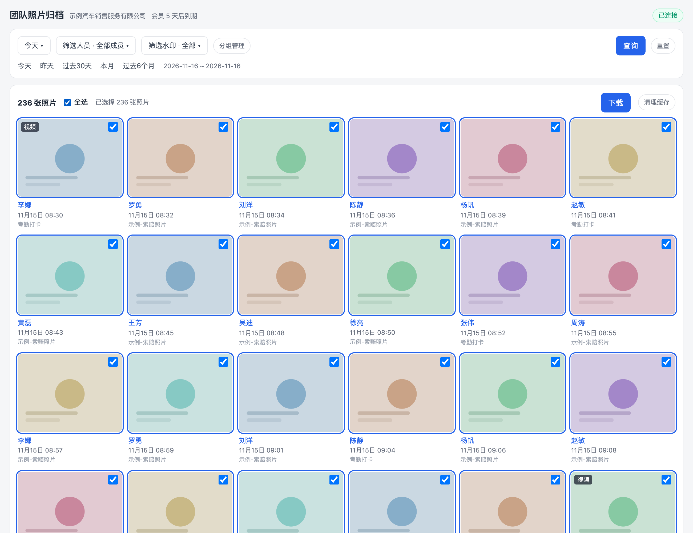

# 今日水印相机照片归档（wmc-export）

把 `https://www.5181688.com/photo/all` 后台里**你能看到的**照片和视频，按
**日期区间** + **人名**自动下载归档到本地。

## 两种用法

| | 命令行版（本 README） | 浏览器插件版 |
| --- | --- | --- |
| 适合 | 大批量/定时/自己用 | 给同事用、不想装环境 |
| 安装 | Node + `npm install` | Chrome 加载已解压扩展 |
| 登录 | 扫码一次，会话存在 `.browser-profile/` | 插件内弹窗登录（手机号/微信扫码），或复用浏览器已有登录态 |
| 写入位置 | 任意路径 | 你选的文件夹（可写 NAS/移动硬盘） |
| 入口 | `npm run export` | [extension/README.md](extension/README.md) |

插件界面预览：

## 边界（请先读）

- ✅ 用**你自己的账号**、**你自己的登录会话**，抓**你能正常浏览**的内容。
- ❌ 不伪造登录态、不绕过会员付费限制、不抓别人的团队、不破解下载按钮。
- 会员过期的「批量导出」是付费功能，本工具不冒充它；它做的是「把手工一张张
  另存为换成脚本自动做」。
- 照片里有真人、车牌、单据等信息，属于企业/个人信息。只在自己有权限的范围内
  使用，不要外传。
- 默认限速（并发 4、翻页间隔 400ms），避免给对方服务器压力、降低账号风控概率。

## 已验证的事实（2026-11-15 实测）

| 项目 | 结果 |
| --- | --- |
| 列表接口 | `POST https://webapi.5181688.com/v5/workgroup/photos` |
| 分页方式 | 游标：响应 `payload.lastPageCond` 回传给下一次请求 |
| 每页条数 | 100 |
| 日期过滤 | 请求体 `filter.times = [{start, end}]`，跨月/跨年都生效 |
| 人名 | 每条记录自带 `userNickname`（如「张伟」） |
| 原图 | `largeURL`（无水印压缩，原尺寸，例 1707×1280） |
| 视频 | `mediaType=1` 时取 `videoURL`（.mp4） |
| 需会员才可看 | `temporaryPhotoThaw.isRestricted` / `isLimitViewByPhotoCount` → **跳过并在报告里计数** |
| CDN | `net-cloud-tx.xhey.top`，直接可下，无需 cookie |
| 数据量参考 | 单日约 230~310 张、20~30 人；历史可追溯到 2025-12 及更早 |

⚠️ 探测时页面显示「会员 5 天后到期」。到期后「批量下载」会不可用，且部分照片可能
被标记为受限（脚本会跳过、不会硬闯）。**要备份就趁现在。**

## 环境

- macOS + 本机 Google Chrome（用 `channel: 'chrome'`，不额外下载浏览器）
- Node.js ≥ 18（本机 v24 已验证）

## 使用步骤

```bash
cd wmc-export
npm install

# 1. 登录（唯一需要你动手的一步）：弹出 Chrome，自己扫码/输验证码
npm run login

# 2. 探测接口（换了账号/网站改版后重跑一次即可）
npm run probe

# 3. 试跑：只统计不下载，先看每天多少张
npm run export -- --from 2026-11-13 --to 2026-11-15 --dry-run

# 4. 正式导出
npm run export -- --from 2026-11-13 --to 2026-11-15

# 只导某个人
npm run export -- --from 2026-11-01 --to 2026-11-15 --name 张伟
```

## 参数

```
--from YYYY-MM-DD   起始日期（含）
--to   YYYY-MM-DD   结束日期（含）
--out DIR           输出目录（默认 ./photos）
--name 张三         只导出某个人
--limit N           只处理前 N 条（试跑用）
--jobs N            并发下载数（默认 4，最大 8）
--page-delay MS     翻页间隔（默认 400ms）
--dry-run           只统计不下载
--headed            显示浏览器窗口（调试用）
```

## 输出结构

```
photos/
  张伟/
    2026-11-15/
      张伟 2026-11-15 18_34_46 示例-索赔照片.jpg
    2026-11-14/
      ...
  陈静/
    2026-11-15/
      陈静 2026-11-15 15_56_45 示例-索赔视频.mp4
_manifest.jsonl      # 已下载清单（人名/时间/路径），断点续传与去重用
_failed.json         # 仅在有失败时生成，重跑同一命令会自动补下
```

- 命名规则与平台导出一致：**姓名 日期 时间 水印名称.扩展名**（示例 `王某 2020-09-03 20_41_18 打卡水印.jpg`）。
- 水印名称是**逐张精确**的：列表接口只给 base 类型，脚本用 `{watermarkBaseID, groupWatermarkID}`
  反查模板并逐张映射（各模板互斥、计数之和等于区间总数）。加 `--no-watermark` 可关掉这一段。
- 图片保留**原图分辨率**（`largeURL`），不是缩略图。
- 同一张不会重复下载：脚本按记录 `seq` 去重，中断后重跑会跳过已完成部分。
- 文件名不含空格和特殊字符，兼容 Windows / NAS / 网盘同步。

## 目录说明

| 路径 | 作用 |
| --- | --- |
| `.browser-profile/` | 你的登录态（等同密码，**不要外传、不要提交 git**） |
| `probe/` | 探测到的接口响应、页面 HTML、截图（含个人信息，同样别外传） |
| `photos/` | 导出的照片/视频 |
| `src/login.mjs` | 登录：用你自己的账号建立会话 |
| `src/probe.mjs` | 探测：录制列表接口、分页参数、页面截图 |
| `src/export.mjs` | 导出：按日期区间 + 人名归档下载 |

## 常见问题

**Q：登录后提示"没抓到列表接口"？**
A：会话过期了。重跑 `npm run login`。

**Q：会员到期后还能用吗？**
A：只要登录后仍能看到照片列表，就能导出你看得到的那些；被标记受限的会跳过。

**Q：会被封号吗？**
A：本工具做的是普通浏览 + 下载图片，已内置限速和并发限制。仍建议分批、别 24 小时
挂着跑；大批量导出本身可能触发平台风控。

**Q：导出中断了？**
A：直接重跑同一条命令，已下载的会跳过，失败的从 `_failed.json` 补。

## 使用范围与免责

- 仅用于**导出你自己团队、你自己账号有权限查看**的照片与视频。
- 不提供任何绕过会员/付费限制的功能：标记「需会员」的内容一律跳过，不硬闯。
- 使用前请自行确认符合平台服务条款与贵司的数据管理规定；导出内容含个人信息（人脸、车牌、地址等），请妥善保管。
- 本项目与「今日水印相机」官方无关；所用接口来自网页端自身请求，对方改版后可能失效。
- 公开仓库中的示例数据（姓名、公司、地址）均为虚构。
