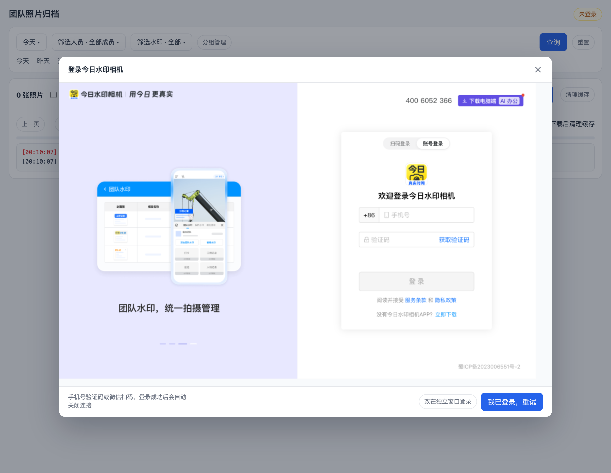
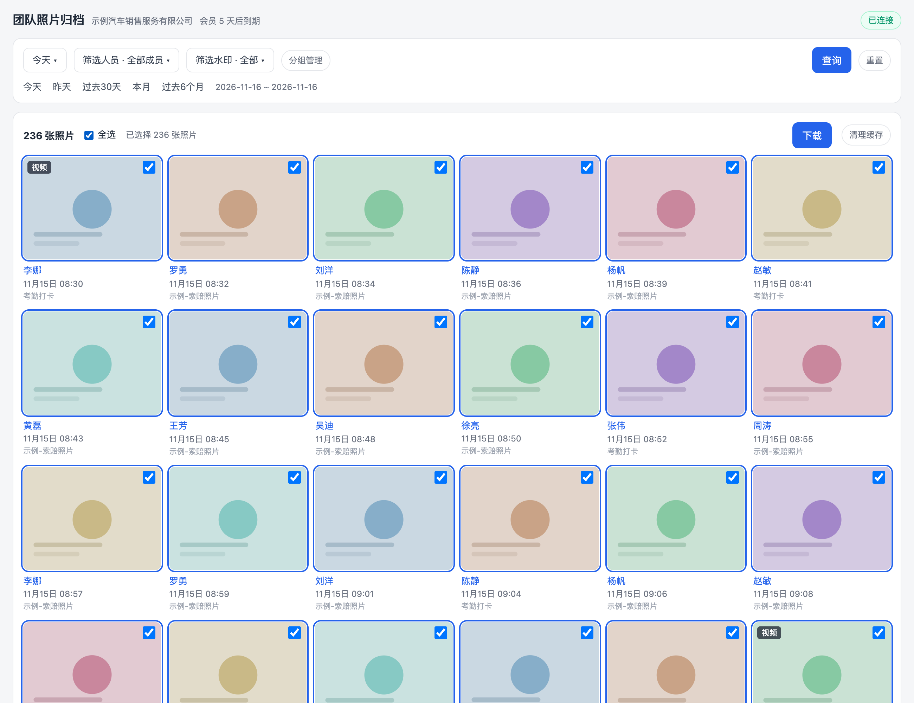
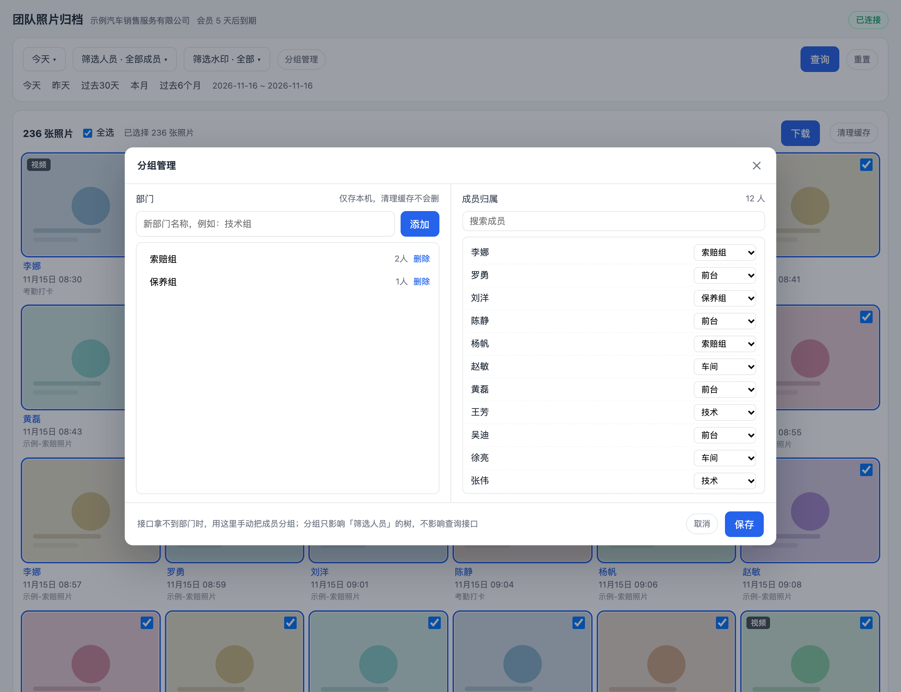
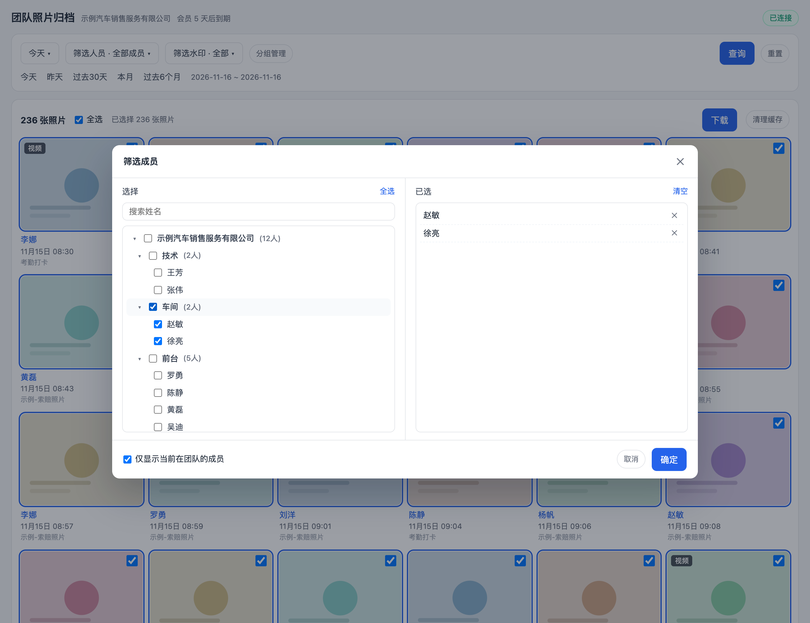
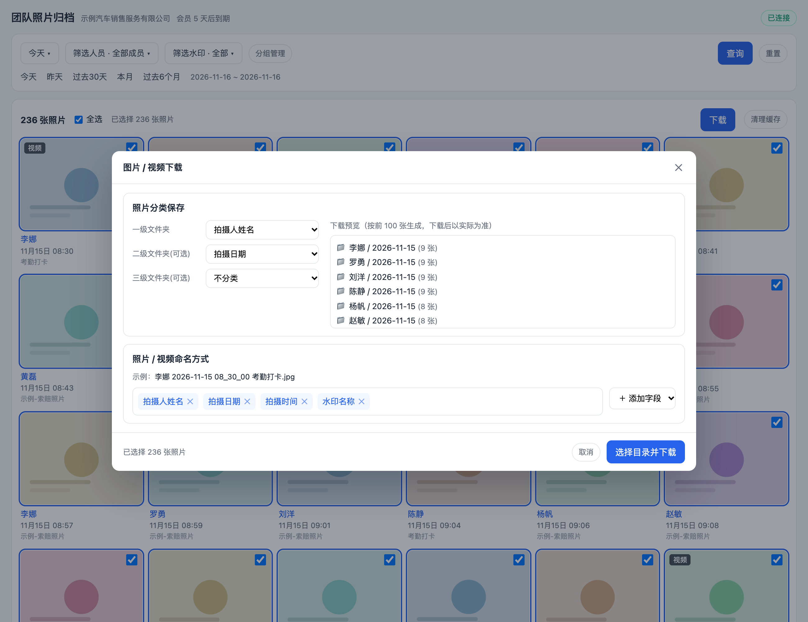

# 浏览器插件版（MV3）

界面照今日水印相机后台做的：**日期弹窗 / 成员树筛选 / 缩略图网格 / 大图预览 / 勾选下载**。

## 安装（一次性）

1. `chrome://extensions/` → 右上角打开 **开发者模式**
2. **加载已解压的扩展程序** → 选中本目录
3. 工具栏出现蓝色相机图标（可点图钉固定）

> Chrome 137 起禁用命令行 `--load-extension`，手动加载依旧可用。
> 不建议上架商店（"批量抓取站点资源"类插件容易被审核下架），内部分发即可。

## 插件内登录（不用单独打开后台页面）



没登录时打开插件会直接弹出登录窗，里面就是今日水印相机**自己的登录页**：

- 手机号 + 验证码（含滑块验证）
- 微信扫码（扫码关注公众号快捷登录）
- 登录成功后弹窗**自动关闭**，插件自动连接并查询当天照片
- 也可点「改在独立窗口登录」用一个小窗口打开（兜底）

**为什么是内嵌页面而不是纯接口登录**：登录态是站点域上的 cookie，滑块验证码和微信扫码都必须
在站点自己的页面里渲染。扩展页是另一个源，无法代填、也不该绕过验证码——所以把站点页面嵌进来，
视觉上不离开插件，握手仍在站点域完成。插件不接触你的密码，也不保存任何凭据。

> **不需要任何额外标签页**：接口由扩展页直接请求（登录 cookie 是 `SameSite=None`，
> 且扩展的 `host_permissions` 让扩展页不受 CORS 限制；实测扩展页直连 webapi 返回 200）。
> 只有在浏览器策略拦截直连时（例如强制屏蔽第三方 cookie），才会自动回退成
> 「在后台标签页里发请求」，日志会写明原因。
>
> 若站点哪天加了 `X-Frame-Options` 导致内嵌登录失效，用「改在独立窗口登录」即可。

## 打开即自动做两件事

1. **自动连接**（`chrome.scripting` 按需注入，不依赖 content script，装完/重载插件都不用刷新）
2. **自动查询当天**的照片并渲染网格（只跑一次），省掉一次点击

## 用法：筛选 → 查询 → 勾选 → 下载



**① 筛选**（工具条，和后台一致）

- **日期**：点开弹窗——
  - 左侧「快速选择」**两列胶囊按钮**共 15 项（今天/昨天/本周/上周/本月/上月/今年/去年/过去7天/30天/2月/3月/6月/一年/所有时间），选中的为实心蓝
  - 右侧「多天」**双月日历**：左日历是选中月的前一月、右日历是选中月，各带 **年/月下拉**；点第一天设起点、点第二天设终点（反选自动交换）；「单天」只显示一个月、点一天即选
  - 底部实时显示 `2026-11-14 至 2026-11-14 共1天`；今天用浅蓝底标出，范围两端为实心蓝
  - 工具条下方还有 今天/昨天/过去30天/本月/过去6个月 的文字快捷键
- **筛选人员**：点开弹窗，左边是团队 → 部门 → 成员的树，可展开、可按姓名搜索、可勾整个部门；
  右边是「已选」列表，可逐个移除。底部「仅显示当前在团队的成员」对应在职状态。

  > 部门来自组织架构接口。**该接口要求传"当前登录用户"的 userID**，传别人的 id 或空值会返回
  > `verify error`、部门列表为空（这是早期版本部门不显示的根因，已修）。

- **分组管理**：接口拿不到部门、或者你想有自己的分类时，用它手动建部门并把成员归进去。

  

  - 左侧建/改/删部门（可重命名），右侧给每个成员选归属部门
  - 存在 `chrome.storage.local` 的独立键 `wmc-groups-v1`（按团队 ID 分开）
  - **清理查询缓存不会删它**；关掉浏览器再打开也还在
  - 自定义部门只影响「筛选人员」的树，查询时仍然按成员 id 过滤，所以不受接口限制

  

- **筛选水印**：按水印模板多选。

**② 查询**：只读数据，不下载。查完按**全部结果**渲染网格（每页 100 张）。

某天没有照片时会给空状态提示（日期、当前时间、以及「查昨天（312 张）」「查最近 7 天」两个入口），
避免刚过零点看到空白以为坏了。

**③ 勾选**：右上角「全选」= 选中**全部结果**（和后台一样，不是当前页）；也可在格子上逐个勾。
标记「需会员」的格子有遮罩、不能勾选，也不会被下载。

**④ 预览**：点缩略图开大图；左右箭头或键盘 ← → 切换，Esc 关闭；视频直接播放；右上角「下载这张」。

**⑤ 下载**：点「下载」→ 先弹「图片/视频下载」设置框 → 选目录 → 只下勾选的。



设置框里就是**目录分层 + 文件命名**的定义（和后台一致）：

- **照片分类保存**
  - 一级文件夹：不分类 / 拍摄人姓名 / 拍摄日期 / 水印名称 / 部门 / 拍摄地点
  - 二级、三级文件夹（可选）：同上，默认「不分类」
  - 右侧「下载预览」按前 100 张实时生成目录树和每层张数
- **照片 / 视频命名方式**
  - 标签式：拍摄人姓名 / 拍摄日期 / 拍摄时间 / 水印名称 / 部门 / 拍摄地点
  - 点 ✕ 移除、下拉「＋ 添加字段」追加，顺序按标签顺序
  - 上方「示例」实时显示生成的文件名
- 底部显示已选张数，确认后才弹目录选择框

默认布局是 `拍摄人姓名 / 拍摄日期` + `姓名 日期 时间 水印名称`，即
`张伟/2026-11-15/张伟 2026-11-15 18_34_46 打卡水印.jpg`。

> 后台那个「同时下载去水印照片」开关没有做：我们拿不到去水印版本的原图，
> 硬加只会给人错觉。

## 命名规则

与平台导出一致：**姓名 日期 时间 水印名称.扩展名**

```
王某 2020-09-03 20_41_18 打卡水印.jpg
```

水印名称逐张反查：列表接口只给 base 类型（如 `21`），插件用
`{watermarkBaseID, groupWatermarkID}` 反查模板再逐张映射；各模板互斥、
计数之和等于区间总数，所以能精确到每一张。

## 不记录、直接覆盖、用完即清

按需求有意这样设计：

| 行为 | 实现 |
| --- | --- |
| **不记录"已下载"** | 没有 IndexedDB、没有 manifest、没有跳过逻辑 |
| **同名直接覆盖** | 写文件时 `createWritable()` 默认清空原内容，按系统逻辑覆盖 |
| **缓存用完即清** | 下载完成后自动清空内存里的查询结果、勾选状态、预览资源（可在右下角取消勾选「下载后清理缓存」） |
| **目录不记忆** | 每次下载都弹目录选择框，不持久化授权 |

「清理缓存」清的是插件内存里的数据（列表、选择、预览）。Chrome 自己的图片/网络缓存
由浏览器管理，插件无法也不应该去删。

## 它怎么工作

```
归档界面(扩展页) ──chrome.scripting.executeScript──▶ 5181688 页面里执行 fetch
        │                                            （自动带页面 cookie）
        │◀──────────── 每页 100 条 JSON ─────────────┘
        ▼
   拉 CDN 原图/视频（host_permissions，不受 CORS 限制）
        ▼
   File System Access 直接写入你选的目录
```

1. **接口请求注入到站点页执行**：自动带页面登录态（从扩展页直接 fetch 时，站点
   `SameSite=Lax` 的 cookie 不会带，接口会 401）；同时**不依赖 content script**，
   所以装完/重载插件都不需要刷新页面，打开即连。
2. **媒体走扩展页**：有 `host_permissions`，拉 CDN 不受 CORS 限制。
3. **写盘用 File System Access**：弹窗选目录，不限下载目录、不刷爆下载列表，
   能直接写到 NAS / 移动硬盘。

## 筛选语义（踩过的坑）

`departmentIDList: ['0']` 表示"全部部门"，**它会盖掉人员筛选**（再传 `userIDList`
依然返回全部）。所以插件里选了人就传 `departmentIDList: []`：

- 只按人：`departmentIDList: []` + `userIDList: [...]`（实测 张伟 → 3 张）
- 只按部门：`departmentIDList: [部门id…]`（实测 技术 20 / 车间 37 / 前台 156）
- 都不选：`departmentIDList: ['0']`

## 非会员账号会怎样

今日水印相机把「照片查看」「批量下载」列为会员权益。非会员账号下，平台会在接口里把这些照片
标记为受限（`temporaryPhotoThaw.isRestricted` / `isLimitViewByPhotoCount`），本工具会**跳过**它们，
并在日志里写清楚：

```
受限照片 236/236 张（平台标记需会员，本工具不下载、不绕过）
诊断样例：temporaryPhotoThaw.isRestricted=true · isLimitViewByPhotoCount=false · 原图地址=有
平台口径 notvip/count：isVip=0 · 受限 236 张
当前筛选下全部照片都受限，可下载 0 张 —— 这是平台对非会员的限制
```

**这不是插件能解决的问题**：插件不伪造会员状态、不绕过平台的付费限制。

非会员账号仍有用的一件事：点 **导出清单** 把结果导成 CSV（姓名 / 部门 / 拍摄时间 / 类型 /
水印 / 是否受限 / 预计文件名），只含元数据不含照片。管理员拿这份清单用有会员的账号照着导，
就能把同事要的照片补齐。

## 已知限制

| 限制 | 说明 |
| --- | --- |
| 需要 5181688 页面 | 负责携带登录态发请求；没开时插件会自动开一个并提示登录 |
| 关掉扩展页会中断 | MV3 的限制；已下载的文件不受影响 |
| 需会员的照片 | 遮罩 + 复选框禁用，不下载、不绕过 |
| 超大区间 | 6 个月约 5 万条，查询本身要几万个请求，建议按周/月分批查 |
| 浏览器图片缓存 | 由 Chrome 管理，插件不介入 |

## 安全

- 全程只在你本机跑，**没有任何数据上传**
- 不带 token 输入框：用你自己浏览器里已有的登录态。别人装上就是在**他自己的账号**下运行
- 无第三方依赖，代码可读：`app.js`（界面 + 4 个注入页面的请求函数）

## 自动化测试

```bash
cd wmc-export
node test/test_b_ui_e2e.mjs          # 48 项：自动连接/自动查询/部门/日期弹窗/成员树/分组持久化/预览/下载/覆盖/清缓存
node test/test_a_content_fetch.mjs   # 真实接口：页面上下文能拿到列表
```
